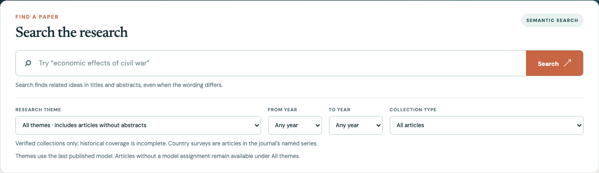
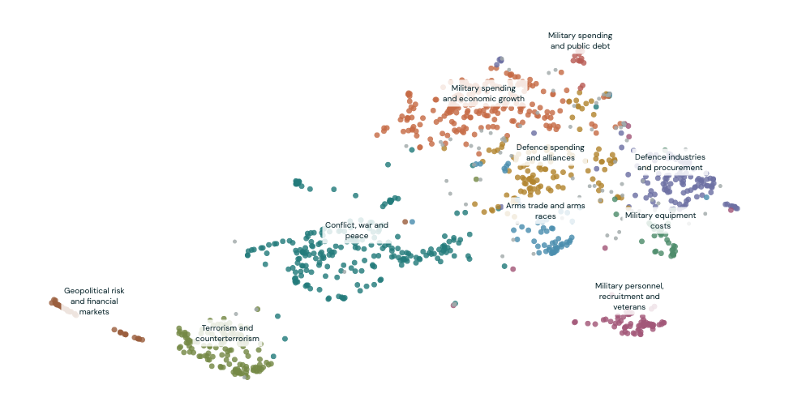
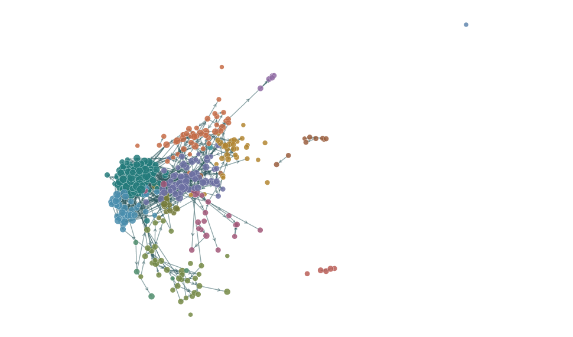

## A starting point for research

Use the index to **support a research task**, **keep up to date with developments in the field**, and **identify influential articles**.

- **Articles:** browse issues, read abstracts and search for related ideas.
- **Topics:** explore themes and how their share changes over time.
- **Citations:** follow references between papers and rank articles by recorded citations.

[Open the tool](https://defenceeconomist.github.io/dpeindex/)

## Search by words or by meaning

**Semantic search** looks for related ideas, even when papers use different words. Try “economic effects of civil war”.

{.search-image}

Read the abstract, the short summary of a paper, to decide whether the result fits your question.

## Browse issues and focused collections

**Browse by volume and issue** to see papers together in their published context.

Use the main page filters to narrow results by research theme and publication year, then choose:

- **Special issues:** collections of papers organised around a shared subject.
- **Country surveys:** articles reviewing defence and peace economics in a particular country.

Choose an individual special issue or country. Collection membership is checked separately from the computer-generated themes.

## Explore the research themes

A **topic model** groups abstracts with similar language. Select a theme or a dot to find papers; use the topic hierarchy to explore related themes.

{.map-image}

Nearby dots have similar abstracts. The map is an approximation; some papers remain unassigned.

## Keep up to date with the field

1. Browse the newest available volume and issue.
2. Set a recent year range and a theme relevant to your work.
3. Read the abstracts and open promising articles.
4. Use **Themes over time** on the Topics page to see changes in subject coverage.

Check the site's data and model dates. New records appear after the catalogue is updated and published; this is not a live alert service.

## Identify influential articles

A **citation** is a reference from one paper to another. The Citations page connects papers through these references.

{.map-image}

Use **Paper rankings → Citations in** to find papers cited most often within the included journal articles. Filter by year, citation count or community, then select a paper to follow its links.

## Support a research task

For a project on military spending and growth:

1. Search your question and read the most relevant abstracts.
2. Use Topics to find neighbouring lines of research.
3. Use Citations to identify frequently cited papers and follow their references.
4. Open the full articles, assess their methods and findings, and build your reading list.

The tool helps you find and organise evidence. Read the papers before drawing conclusions or citing their findings.

## Read articles through your library

Open the article's publisher link to **Taylor & Francis Online**.

For subscription articles, **log in through your institution using your library or university login**. Choose your institution and complete its sign-in steps, or start from your library's journal link.

Access depends on your library's subscription. On a recognised campus network, access may be automatic; open-access articles do not require a subscription.

The index provides article details and abstracts, not a subscription to the full texts. Enter library credentials only through your institution's sign-in service.

::: {.source}
[Taylor & Francis: institutional access guide](https://files.taylorandfrancis.com/how-do-i-view-content-user-guide..pdf)
:::

## Where the data comes from

**Bibliographic data** means article details such as titles, authors, publication dates and abstracts.

- These come from **Taylor & Francis's RePEc feed**. RePEc stands for Research Papers in Economics; its ReDIF file is a structured catalogue of the journal's records.
- Reference lists and publication identifiers used for the citation network come from **Crossref**, where publishers deposit publication information. Matches are checked before links are included.
- Research themes and citation communities are computed by this project. They are not classifications supplied by the publisher.

::: {.source}
[Journal catalogue on RePEc](https://ideas.repec.org/s/taf/defpea.html) · [Source ReDIF file](ftp://ftp.repec.org/opt/ReDIF/RePEc/taf/defpea/defpea.redif) · [Crossref metadata](https://www.crossref.org/documentation/retrieve-metadata/rest-api/) · [Project methods](https://defenceeconomist.github.io/dpeindex/research-note/)
:::

## Read the maps and rankings with care

- Citation counts cover **links within the included DPE papers**, not citations from the whole research literature.
- Older papers have had more time to collect citations. A high count indicates attention within this collection, not necessarily quality or agreement.
- Missing abstracts, reference lists and early papers leave gaps. The catalogue used in the current analysis begins in **1997**.
- A **citation community** is a group linked by references. It may contain several subjects, and its name is a guide for further reading.

The research report explains coverage, methods and limitations in more detail.

## Explore the tool

[**Browse articles**](https://defenceeconomist.github.io/dpeindex/)  
Search a question or start with a recent issue.

[**Explore topics**](https://defenceeconomist.github.io/dpeindex/topics/) · [**Follow citations**](https://defenceeconomist.github.io/dpeindex/citations/)  
Find related research and papers worth reading closely.

[Research report](https://defenceeconomist.github.io/dpeindex/research-note/) · [Python documentation](https://defenceeconomist.github.io/dpeindex/python-docs/) · [GitHub repository](https://github.com/defenceeconomist/dpeindex)

[Download these slides as PDF](https://defenceeconomist.github.io/dpeindex/slides/tool-guide.pdf)
